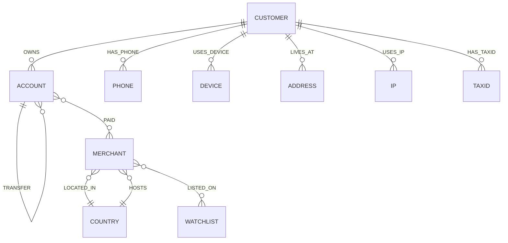

# AegisGraph-Agent

A FalkorDB-powered AML investigation agent for tracing financial crime patterns across customer, account, transfer, merchant, and identity relationships.

Track entered: Agents That Act on Connected Data

## Product summary

AegisGraph-Agent turns a connected transaction graph into an auditable investigation workflow. It seeds a synthetic AML graph with:

- Customers and the accounts they own
- Cash transfers between accounts
- Merchant payments and risky jurisdiction destinations
- Shared identity artifacts (phones, devices, addresses, IPs, tax IDs)
- Watchlist-linked merchants and high-risk countries

The application combines FalkorDB Cypher queries with graph algorithms to surface risk signals such as smurfing, shared-identity rings, weakly connected clusters, and intermediary dominance.

## Setup instructions

### 1) Create a Python environment

```powershell
python -m venv .venv
.\.venv\Scripts\Activate.ps1
pip install -r requirements.txt
Copy-Item .env.example .env
```

### 2) Configure FalkorDB

Update `.env` with your local or remote FalkorDB connection settings:

```env
FALKORDB_HOST=127.0.0.1
FALKORDB_PORT=6379
FALKORDB_GRAPH=aegisgraph
FALKORDB_USERNAME=
FALKORDB_PASSWORD=
FALKORDB_SSL=false
```

If you are using FalkorDB inside Docker or a remote deployment, replace the host with the reachable endpoint.

### 3) Seed the graph data

```powershell
python aegisgraph.py seed
```

For a fresh graph reset:

```powershell
python aegisgraph.py seed --reset
```

### 4) Run the API and dashboard

```powershell
uvicorn app.main:app --reload
```

Open the dashboard at:

- http://127.0.0.1:8000/
- http://127.0.0.1:8000/health
- http://127.0.0.1:8000/schema
- http://127.0.0.1:8000/graph/summary
- http://127.0.0.1:8000/accounts
- http://127.0.0.1:8000/investigate/transfers
- http://127.0.0.1:8000/investigate/shared-devices
- http://127.0.0.1:8000/docs

## Graph data model

The product uses a single connected graph named `aegisgraph` with the following node and relationship model.



### Node labels

- `Customer`: natural person who owns financial accounts
- `Account`: bank or payment account under investigation
- `Merchant`: business or payment counterparty
- `Country`: geographic location; `high_risk` marks jurisdictions of interest
- `Watchlist`: sanctions or risk watchlist entity
- `Phone`, `Device`, `Address`, `IP`, `TaxID`: identity and behavioral resources shared across customers

### Relationship types

- `OWNS`: customer-to-account ownership
- `TRANSFER`: monetary movement between accounts
- `PAID`: account-to-merchant payment
- `LOCATED_IN`: merchant-to-country placement
- `LISTED_ON`: merchant-to-watchlist mapping
- `HAS_PHONE`, `USES_DEVICE`, `LIVES_AT`, `USES_IP`, `HAS_TAXID`: customer identity linkage relationships

This graph is intentionally designed so the same person or network can be explained through multiple connection types: funds flow, common identity artifacts, and watchlist exposure.

## Core Cypher queries and graph algorithms

The application depends on these graph operations from `aegisgraph.py` and `app/graph_service.py`.

### Ownership lookup

```cypher
MATCH (c:Customer)-[:OWNS]->(a:Account {id:$account_id})
RETURN c.id, c.name
```

### Risk-path traversal to high-risk jurisdiction

```cypher
MATCH p=(a:Account {id:$account_id})-[:TRANSFER*1..5]->(:Account)
      -[:PAID]->(m:Merchant)-[:LOCATED_IN]->(c:Country {high_risk:true})
RETURN [n IN nodes(p) | n.id] AS ids, m.id, m.name, c.name,
       [r IN relationships(p) | r.amount] AS amounts
LIMIT 10
```

### Shared-identity signal inside a connected network

```cypher
MATCH (c1:Customer)-[r1]->(res)<-[r2]-(c2:Customer)
WHERE c1.id < c2.id AND c1.id IN $network_customers AND c2.id IN $network_customers
  AND type(r1) IN ['HAS_PHONE','USES_DEVICE','LIVES_AT','USES_IP','HAS_TAXID']
RETURN c1.id, type(r1), res.id, c2.id
```

### Structuring / fan-in pattern

```cypher
MATCH (s:Account)-[t:TRANSFER]->(x:Account)
WHERE t.amount >= $lo AND t.amount < $thr
WITH x, count(DISTINCT s) AS senders, sum(t.amount) AS total, count(t) AS n
WHERE senders >= 3
RETURN x.id, senders, n, total
ORDER BY senders DESC
```

### Graph algorithms used

- Weakly connected components: `CALL algo.WCC(...)` with `['Customer','Account', ...]` and `['OWNS','TRANSFER', ...]`
- Betweenness centrality: `CALL algo.betweenness({nodeLabels:['Account'], relationshipTypes:['TRANSFER']})`
- Community detection: `networkx.community.louvain_communities(..., weight='weight')`
- Fallback graph analytics: `networkx.betweenness_centrality(...)` and `networkx.node_connected_component(...)`

## Example investigation flow

1. A suspicious account is selected from the dashboard.
2. The agent resolves ownership and defines the connected component.
3. It checks structuring, shared identity links, transfer paths to high-risk jurisdictions, and watchlist exposure.
4. The results are returned as evidence-backed findings plus a draft SAR narrative.

## Notes for submission

This repo is structured for the Graph Hacks rules and is designed around FalkorDB as the primary graph database. For an actual hackathon submission, you would complete the remaining external requirements by:

- publishing the source code in a public GitHub repository,
- recording a demo video showing the working project,
- deploying the app or providing complete local setup instructions,
- naming the track as `Agents That Act on Connected Data`.

## License

This project is provided for educational and hackathon use. Check the repository owner’s policy before production deployment or commercial reuse.
